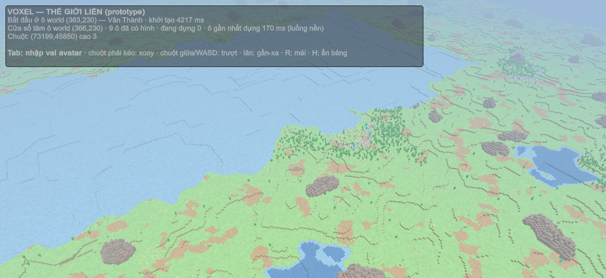
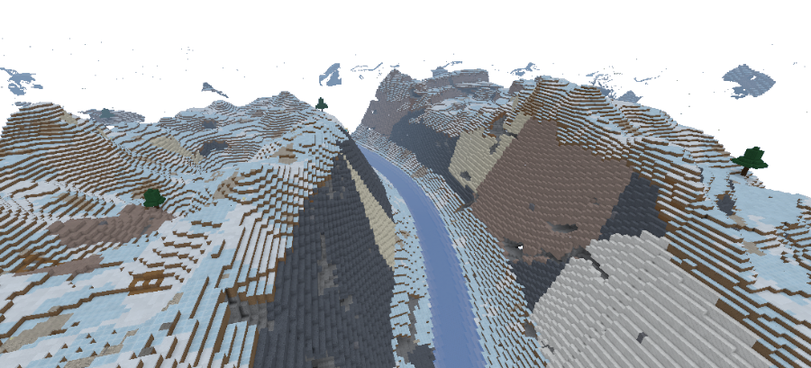
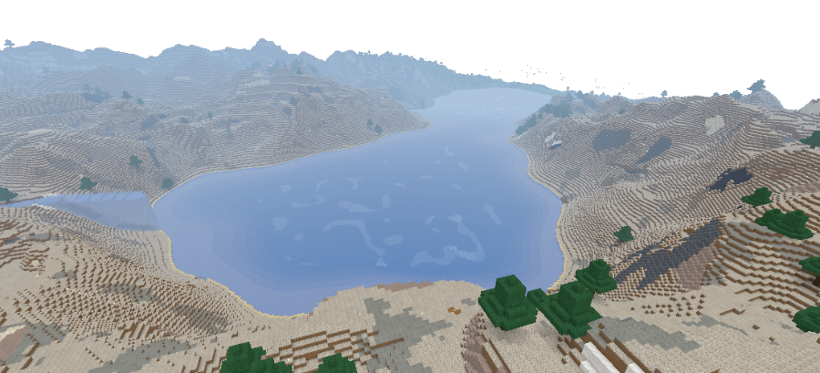
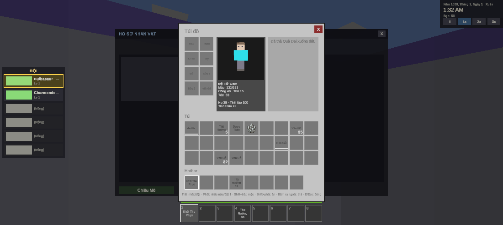
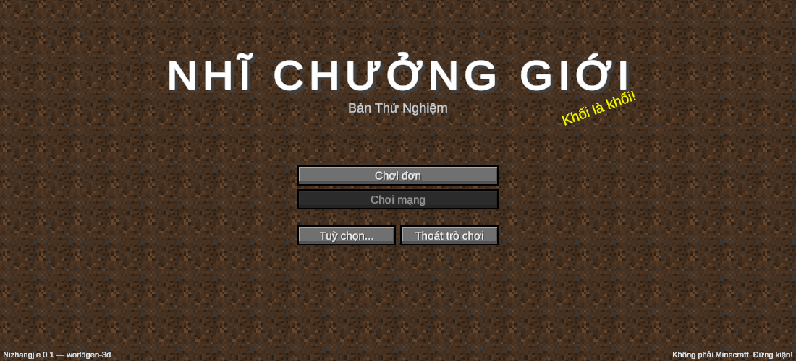

# Nizhangjie — nhật ký thiết kế & kỹ thuật của một game sandbox 3D (Unity / C#)

> **EN summary.** A solo-developer Unity/C# project built from **26 May to 23 Oct 2026**: a simulation engine (colony-sim + Minecraft-style voxel world + creature collecting) whose content is fully moddable through JSON data and C# hooks. I built it together with an AI coding assistant (Claude Code): I decided the goals, the design trade-offs and what "done" means; Claude measured, wrote code, ran tests and kept notes. This repository is **not the source code**. It is the **process**: plans, measurements, mistakes, fixes, decisions and screenshots. Start with [DESIGN_MISTAKES](DESIGN_MISTAKES.md), the [case studies](#case-studies) or the [timeline](TIMELINE.md).



| | |
|---|---|
|  |  |
|  |  |

*Từ trái sang phải, trên xuống: thế giới khối liền · sông trong hẻm núi · hồ · túi đồ góc nhìn thứ nhất · màn hình chính. Toàn bộ là ảnh chụp từ game đang chạy.*

## Chơi như thế nào (giới thiệu nhanh)
Người chơi bước vào một thế giới làm bằng khối, giống Minecraft: đào, xây, bơi, đi qua hang, sông, hồ và núi. Thế giới có thành phố với cư dân tự sinh sống: họ đi làm, kết bạn, nói chuyện và nhớ những chuyện đã xảy ra giữa hai bên. Người chơi có thể nhìn game như một bản đồ quản lý khu định cư (kiểu RimWorld) hoặc đi bộ ở góc nhìn thứ nhất, thu phục sinh vật hoang dã và đánh theo lượt, trồng trọt, chế tạo đồ.

Điều khiến dự án này khác một game thông thường: **phần lõi là một engine mô phỏng**, còn tu tiên, sưu tập sinh vật hay bất kỳ chủ đề nào khác chỉ là gói nội dung cắm thêm bằng file dữ liệu.

## Đây là gì
Game kết hợp **quản lý khu định cư** (kiểu RimWorld), **thế giới khối** (kiểu Minecraft/Hytale), **thu phục sinh vật** (kiểu Pokémon) và **tu tiên**. Mục tiêu thật của dự án: *một engine mô phỏng thế giới* mà nội dung nào cũng cắm vào được (tu tiên, Pokémon, Tensura… đều chỉ là "mod").

Đây là nhật ký của dự án, tôi viết cho người muốn biết **tôi nghĩ và làm việc như thế nào**: tôi lập kế hoạch ra sao, khi sai thì chúng tôi sửa thế nào, vì sao tôi chọn phương án này thay vì phương án kia, và kết quả là gì — kèm bằng chứng (số đo, test, commit, ảnh chụp). Tôi làm dự án cùng Claude (trợ lý AI lập trình): tôi quyết định hướng đi và tiêu chuẩn "xong", Claude đo, viết code, chạy test và ghi tài liệu.

## Con số tóm tắt
| | |
|---|---|
| Thời gian | 26/05 → 23/10/2026 (~5 tháng) |
| Lịch sử git | từ 12/09: **248 commit** (trước đó chưa dùng git — xem [TIMELINE](TIMELINE.md)) |
| Ghi chú làm việc | 200+ file; **56 file** được đưa vào [`docs/lessons`](docs/lessons) |
| Bộ luật dự án | 373 dòng, mỗi luật gắn với một bug thật: [`CODE_SYSTEM_RULE`](docs/CODE_SYSTEM_RULE.md) |
| Ảnh chụp | 129 ảnh theo ngày + 70 ảnh theo chủ đề → [GALLERY](GALLERY.md) |

## Case studies
Mỗi bài có cấu trúc: bối cảnh → vấn đề → giả thuyết/thử sai → quyết định → kết quả có số đo → điều học được → bằng chứng.

| # | Bài | Điểm nhấn |
|---|---|---|
| 01 | [Lag giờ đi làm: 4 lần đoán sai, 1 lần đo đúng](case-studies/01-lag-thanh-pho-bon-lan-doan-sai.md) | **713 ms → 3,26 ms**; thủ phạm không phải pathfinding |
| 02 | [Một dòng cấu hình: 2,8 → 92,6 FPS](case-studies/02-draw-call-tilemap.md) | 367.899 → 70 draw call |
| 03 | [Sự cố prefab dùng chung & quyết định hợp nhất](case-studies/03-su-co-hud-prefab-hop-nhat.md) | phục hồi khi không có bản sao lưu |
| 04 | [Hệ lời thoại NPC: lặp lời 33,1% → 0%](case-studies/04-he-loi-thoai-khong-lap.md) | đại từ tiếng Việt theo quan hệ, không LLM lúc chạy |
| 05 | [Tách lõi mô phỏng khỏi nội dung tu tiên](case-studies/05-tach-loi-khoi-tu-tien.md) | refactor 199 file không vỡ, "phép thử sống-hay-chết" |
| 06 | [Thuật toán sinh nhà nhiều tầng (12–17/09)](case-studies/06-thuat-toan-sinh-nha.md) | lịch sử commit: thử, hoàn tác, viết lại (annealing → BSP) |
| 07 | [Thế giới khối: chunk, ánh sáng, chất lỏng](case-studies/07-the-gioi-khoi-render-anh-sang-nuoc.md) | đánh đổi đo bằng số (gộp mặt 16% vs 56%) |
| 08 | [Viết lại bộ sinh địa hình 3D](case-studies/08-sinh-dia-hinh-3d.md) | bug "cột đá vô tri": 34/37 → 0; ảnh cũ-vs-mới |
| 09 | [Tới được nhưng không tìm được đường](case-studies/09-tim-duong-canreach-findpath.md) | lệch 87 → 11; giả thuyết bị bác bỏ |
| 10 | [Hiệu năng thế giới 3D](case-studies/10-hieu-nang-the-gioi-3d.md) | vào game 12–15 s → 3,8 s; GC 298 → 63 KB/khung |
| 11 | [Kiến trúc mod: JSON ⟂ hook C#](case-studies/11-mod-va-content-pack.md) | vì sao loại Lua; tách 3 gói nội dung khỏi lõi |
| 12 | [Trồng trọt: thiết kế rồi 6 bước = 6 commit](case-studies/12-trong-trot-thiet-ke-roi-code.md) | mở rộng khung có sẵn, không dựng hệ mới |
| 13 | [Độ tin cậy: lưu công trình, Unity treo, RAM](case-studies/13-do-tin-cay-luu-tru-va-su-co.md) | bug lưu "bản cũ" tự tìm ra |
| 14 | [Cách làm việc với AI & bộ luật](case-studies/14-cach-lam-viec-voi-ai-va-bo-luat.md) | "xong = chơi được"; hai tài khoản, bộ nhớ dự án |

> 🧩 **Muốn xem chúng tôi phát hiện và sửa lỗi thiết kế thế nào?** Đọc [`DESIGN_MISTAKES.md`](DESIGN_MISTAKES.md): nhật ký 18 lần thiết kế sai, ai phát hiện, sửa ra sao, tôi rút ra điều gì.

## Nếu bạn chỉ có 5 phút
1. Đọc [case 01](case-studies/01-lag-thanh-pho-bon-lan-doan-sai.md) (sửa sai và đo).
2. Đọc [case 08](case-studies/08-sinh-dia-hinh-3d.md) và xem ảnh cũ-vs-mới.
3. Đọc [DESIGN_MISTAKES](DESIGN_MISTAKES.md) rồi [case 14](case-studies/14-cach-lam-viec-voi-ai-va-bo-luat.md) (quy trình thật, nói thẳng về vai trò của AI).

## Cách tôi làm việc
1. **Thiết kế bằng văn bản trước** → [`docs/`](docs) (trồng trọt, thời tiết, nhiệt độ, combat framework, shop, sự cố thế giới, kiểm toán spaghetti).
2. **Đo trước khi tối ưu**, nhìn đuôi phân phối (p95/p99/max), ép tải.
3. **Ghi lại lỗi, cái đã thử mà tệ hơn, và bẫy khi đo** → [`docs/lessons/`](docs/lessons).
4. **Báo cáo trung thực**: "đã code / test xanh / đã verify Play Mode / chưa verify / chưa rõ nguyên nhân".
5. **Kiến trúc có luật**: dữ liệu (JSON) ⟂ hành vi (C#), lõi ⟂ nội dung, mỗi hệ có test.

## Cấu trúc repo
```
README.md        ← bạn đang ở đây
TIMELINE.md      ← toàn bộ hành trình theo giai đoạn (26/05 → 23/10)
GALLERY.md       ← ảnh chụp có chú thích
case-studies/    ← 14 bài phân tích chi tiết
docs/
  early/         ← tài liệu thiết kế tháng 5–6 (Project Bible, M1–M10, UI/UX, bàn giao)
  lessons/       ← ghi chú kỹ thuật gốc (tiếng Việt), 56 file
  *.md           ← thiết kế các hệ lớn + bộ luật + kiểm toán code
images/          ← prototype/ worldgen/ lighting/ fluids/ city/ ui/ timeline/
```

## Trung thực về giới hạn
- Đây **không phải** một game đã phát hành; một số hệ còn "nợ" và được ghi rõ (ví dụ: RAM chưa phân rã, chi phí dựng ô địa hình +28%, một số lỗi "đường nứt" chưa tái hiện).
- Không có ảnh chụp trước 03/08 và không có commit git trước 12/09 — các mốc đó dựa vào ngày sửa tài liệu và ghi chú.
- Tài liệu trong `docs/lessons` là **ghi chú làm việc gốc**, giữ nguyên tiếng Việt và văn phong thô để thấy quá trình thật.

## Công cụ
Unity 6 (URP) · C# · Burst/Jobs · A*/region pathfinding · JSON data-driven mods · Unity Profiler · MCP cho Unity · git · Claude Code (AI pair-programming).
