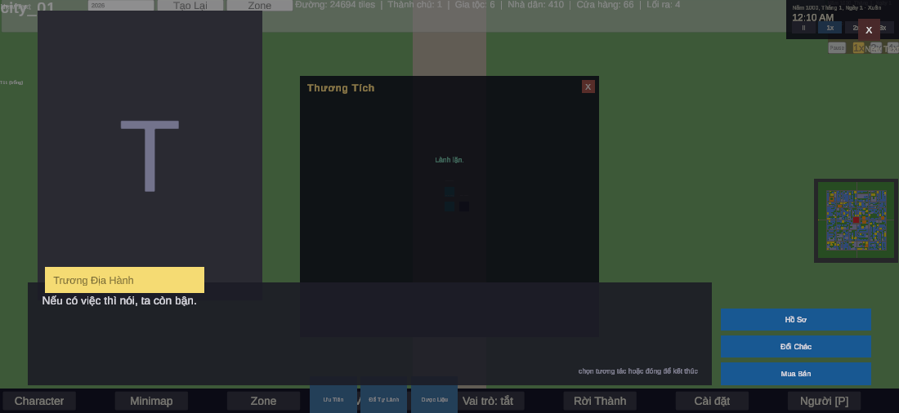

# Case study 04 — Hệ lời thoại cho NPC: lặp lời 33,1% → 0,0%, và cái giá của "một trục lọc"

**Thời gian:** 20–21/08/2026 (M45, M48–M54) · **Kỹ năng:** thiết kế hệ thống nội dung, đo chất lượng bằng test, tiếng Việt/NLP nhẹ.

## Mục tiêu
Nói chuyện với một NPC nhiều lần phải *không nghe lặp*, và NPC nhắc tới *sự việc có thật* từng xảy ra giữa hai người — mà **không dùng LLM lúc chạy** (phá tính tất định của mô phỏng và save/load). Ràng buộc: một người viết nội dung.

## Chuỗi hệ thống (mỗi bước một mốc, mỗi mốc có test)
| Mốc | Việc |
|---|---|
| M45 | Màn hội thoại kiểu visual novel; cột lệnh dùng chung `PawnInteractionRegistry` |
| M48 | **Sử ký khách quan** (sự kiện thế giới, có trần dung lượng) |
| M49 | **Ký ức chủ quan** từng pawn: tin đồn bị méo *tất định* + diễn giải lại theo thiện cảm hiện tại |
| M50 | Chống lặp + đại từ tiếng Việt theo quan hệ |
| M51 | Ghép mảnh thành câu (đòn bẩy khối lượng nội dung) |
| M52 | Lượt thoại 3 nhịp: chào → ký ức → khép lại |
| M53 | Lưu sử ký + ký ức xuống save |
| M54 | Trình soát nội dung thoại + nhân bản lấp lỗ |

## Cái bẫy đo được (lý do cả đợt tồn tại)
6 trục lọc của M49 = **192 ô** tổ hợp; muốn mỗi ô 3 câu thì phải **~576 câu viết tay**.
> **Luật rút ra:** thêm một trục lọc là việc 5 phút trong code nhưng *nhân đôi nợ nội dung vĩnh viễn*. Từ giờ thêm trục phải trả lời được "ai sẽ viết gấp đôi số câu".

## Hai "đòn bẩy" không cần viết thêm chữ nào (M50)
### 1) Chống lặp — sinh từ **số đo**, không từ suy đoán
- Nhớ theo **cặp (người nói → người nghe)**; khoá theo **khung câu** (`defId#lineIndex`) chứ không theo chuỗi đã điền slot (người chơi nhận ra lặp ở khung: "mất 12 máu"/"mất 15 máu" vẫn là một câu).
- Tầng 1 — phạt mềm: **33,1% → 10,5%** lặp liên tiếp (300 lượt × 10 câu). Vẫn nghe ra.
- Tầng 2 — luật cứng "cấm lặp ngay câu vừa nói, *miễn là còn lựa chọn khác*": **0/2700 = 0,0%**, 0 lần im lặng. Điều kiện "còn lựa chọn khác" giữ cho rổ 1 câu không biến pawn thành câm (tệ hơn cả lặp).

### 2) Đại từ tiếng Việt theo quan hệ
Tiếng Anh chỉ có "you" nên phải diễn đạt quan hệ bằng *nội dung câu*; tiếng Việt thì **cặp đại từ chính là quan hệ** (thiện cảm + tuổi + giới + thân sơ). Giải được nó thì mọi câu đã viết tự nhạy quan hệ.
- **Bug thật nó diệt:** hai bảng thoại hardcode "anh/tôi" và "ngươi/ta" → một pawn nói "ngươi" ở câu chào rồi "anh" ở câu ký ức ngay sau, trong cùng một lượt. Giờ giải đại từ **một lần** rồi áp cho cả hai nguồn.
- Chọn **tất định, không random** (xưng hô nhảy qua lại là lỗi người chơi đọc ra), hoà thì so `Id` — không để thứ tự Dictionary quyết định.
- Tự viết hoa đầu câu cho đại từ (nhưng `{days}` thì *cấm* đặt đầu câu — hai lớp lỗi im lặng xử ngược nhau).
- **Chốt chống tái phát:** test quét *mọi* câu thoại thật và đỏ nếu còn "ngươi/mày/tao" hardcode.
- Cơ chế ở lõi, **từ ngữ ở content-pack** (kiếm hiệp "ta/ngươi", hiện đại "tôi/bạn").

## "Đủ tốt" được định nghĩa thành test
> Nói chuyện với cùng một pawn **10 lần liên tiếp**: không câu nào lặp, và ít nhất 3 lần nhắc tới sự việc có thật trong ký ức.

Vế đầu đạt (0/2700). Vế sau phụ thuộc độ phủ nội dung — mình ghi rõ là *chưa đạt hết*.

## Điểm dừng được đặt trước
> "Nếu tới bước ghép mảnh mà thấy 144 câu mặt đọc dở hơn 16 câu viết tay thì **dừng ở (2)** — đó là kết cục hợp lệ, không phải thất bại."

Cũng đã quyết: nhân bản nội dung bằng LLM **offline** (không LLM lúc chạy, vì phá determinism).

## Kết quả
- M50: `Run Speech Tests` **44/44**, hồi quy Memory 83/83, Chronicle 49/49, Trade 84/84, Decoupling 42/42.
- Verify trong Play Mode với cùng một cặp pawn, chỉ đổi thiện cảm: thù → "mày/tao", trung tính → "ngươi/ta", thân → "anh/tôi" (cả lượt đổi giọng nhất quán).
- **M52 lộ ra 2 bug thật:** lines ngược nghĩa giữa 2 bảng; 3 nhịp dùng chung một dòng chống lặp.
- **M53 bẫy:** ký ức bị nhân đôi khi `Restore` đi qua `Record`; ký ức không suy lại được từ sử ký → phải lưu riêng.
- **M54:** 4 ô thủng → 0, câu mặt 70 → 564 (×8,5); công cụ soát tự có 2 điểm mù đã sửa.
- **M51:** bug thiết kế "tone rỗng" bị che — test bắt được.

## Bằng chứng
[M50](../docs/lessons/project_m50_speech_quality.md) · [M54](../docs/lessons/project_m54_speech_audit.md) · ảnh màn hội thoại 20/08: [`images/timeline`](../images/timeline/screenshot-20260820-131525.png)

