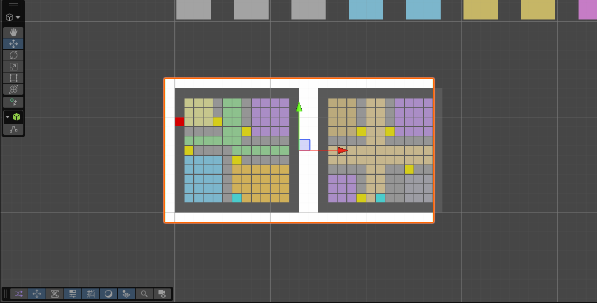
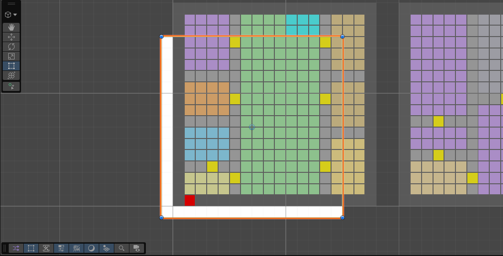

# Case study 06 — Sinh bố cục nhà nhiều tầng: thử, hoàn tác, và viết lại thuật toán (12–17/09/2026)

**Nguồn:** chuỗi 40+ commit git có thật (đây là giai đoạn có lịch sử git đầu tiên) · **Kỹ năng:** thuật toán sinh thủ tục (procedural generation), thử–sai có kỷ luật, tối ưu tổ hợp.

> Mình chỉ viết điều **đọc được trong lịch sử commit và ảnh chụp**; chi tiết cài đặt nằm trong code (không đưa vào repo này).

## Bài toán
Sinh nhà nhiều tầng cho cư dân thành phố: nhiều người/hộ, mỗi người một phòng ngủ, có bếp-ăn, phòng tắm, thang bộ; cửa chỉ nối các phòng hợp lý (phòng riêng chỉ thông với phòng khách/sảnh); mặt bằng không để lại ô thừa vô nghĩa. Song song là migration toàn engine `Vector2Int → Vector3Int` (12/09) để hỗ trợ nhiều tầng.

## Dòng thời gian từ lịch sử commit
**12/09** — Baseline trước migration; chuyển toàn bộ Combat + World/Wild sang `Vector3Int`; prototype xây nhà: planner phòng theo blueprint, thang nhiều tầng, tính cách cư dân theo "bậc" nhà; khớp bậc nhà với bậc NPC thay vì xáo ngẫu nhiên.

**13/09** — Nhiều người một nhà, mỗi người một phòng ngủ → *bug:* "mọi cư dân bị nhồi hết tầng trệt" → sửa chia tầng; *bug:* tỉ lệ đặt phòng ngủ thấp ở bậc cao → tăng diện tích lô theo số người. Rồi một chuỗi **thử–hoàn tác** khá điển hình:
- "Giới hạn cỡ phòng phụ: lặp đặt recipe thay vì chiếm một phòng khổng lồ" → **Revert** → **Reapply** → "sửa tỉ lệ tường bằng vòng lặp + dọn phần dư" → **Revert về trước khi thử**.
- Thêm luật cửa (phòng riêng chỉ nối phòng khách/sảnh), phòng tắm bắt buộc, bếp-ăn gộp. Chỉnh cỡ phòng tắm qua 3 vòng (2×2 "tệ hại" → 5×5 làm bếp-ăn bị thiếu chỗ → chốt 4×4).
- Cầu thang âm tường; bếp-ăn "open-plan" gộp không tường với phòng khách.
- **Tối 13/09: viết lại đặt phòng thành bộ tối ưu toàn cục kiểu Metropolis / simulated annealing.**

**14/09** — Sửa bộ tối ưu dùng *hộp bao* của chiếu nghỉ thay vì các ô thật; tổng quát hoá hình hành lang (chữ thập/I/L) + thử phòng sảnh tầng trệt; một thử nghiệm "nhà bếp tách rời quanh sân" → **Revert**; thử "hấp thụ các ngách tường chết 2×2" → **Revert** (ngay sau 4 phút). Cuối ngày: "**sửa nguyên nhân gốc:** phòng khách/sảnh nhận phần dư bằng *phép trừ tập hợp*, không phải tìm kiếm".

**17/09** — **Viết lại bố cục tầng trệt theo guillotine/BSP — 0% ô thừa theo cấu trúc** (không còn phải "dọn dư" bằng heuristics), bỏ các mảnh dư <2 ô; rồi "**dựng lại bố cục nhà: *partition* cho hình học, *spanning tree* cho lối đi**" (tách hai mối quan tâm: chia mặt bằng và đảm bảo kết nối). Sau đó: chiếu nghỉ thang có footprint 2×3 hướng đúng; thang phải sát tường một cạnh; tránh cửa phòng ngủ–phòng ngủ; thang↔phòng khách; mở rộng bộ phòng (bếp/phòng học/kho/ăn).

## Điều đáng chú ý (cách làm việc)
1. **Hoàn tác là một phần của kỹ thuật.** 4 lần `Revert` có chủ đích; thay vì sửa chồng sửa, cứ lùi lại khi thử nghiệm không có lợi — và lịch sử giữ nguyên bằng chứng "đã thử cái này, không tốt".
2. **Đổi cách nghĩ khi vá mãi không hết:** từ heuristic dọn dư → tối ưu ngẫu nhiên (annealing) → thuật toán *chắc chắn* (BSP) "0% dư theo cấu trúc" — thay vì tiếp tục tối ưu heuristic.
3. **Sửa nguyên nhân gốc, không sửa triệu chứng** (luật D5 trong bộ luật): ví dụ commit 14/09 *"Fix root cause … via set subtraction, not search"*.

## Ảnh
Công cụ trực quan hoá ô phòng trong scene (nhiều màu = nhiều loại phòng; ô vàng = cửa; đỏ = lối vào):

Các ảnh cùng ngày (12/09 → 17/09): [`images/timeline`](../images/timeline)

## Bằng chứng
Lịch sử commit (nhánh `worldgen-3d`, 12–17/09) — repo game; thiết kế liên quan: [`docs/lessons/project_citygen_wallcity.md`](../docs/lessons/project_citygen_wallcity.md)
