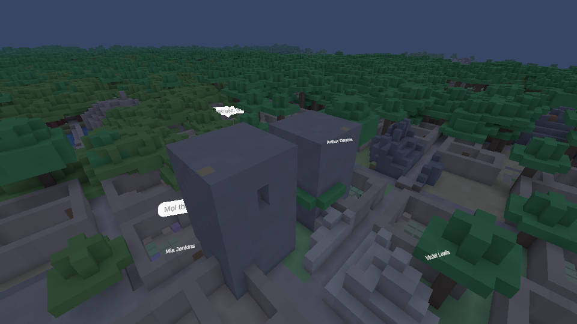

# Case study 07 — Từ bản đồ 2D thành thế giới khối kiểu Minecraft: chunk, ánh sáng, chất lỏng, khối có hình

> **Tóm lược 3 dòng**
> - **Nhầm mục đích:** Giữ hai thế giới (2D và khối) lệ thuộc nhau; thử gộp mặt khi ánh sáng bị nướng vào đỉnh.
> - **Thiết kế đúng ra sao:** 2D và 3D là hai bản vẽ của cùng dữ liệu; chuyển ánh sáng sang shader và texture 3D sau khi đo.
> - **Bài học:** Đo trước khi chọn kỹ thuật, và ghi rõ giá phải trả của mỗi lựa chọn.
>
> *Các con số bên dưới lấy từ ghi chú đo lúc đó, không phải thứ cần thuộc lòng.*

**Thời gian:** 08/10 → 15/10/2026 (≈ 60 commit) · **Kỹ năng:** voxel engine, mesh/shader, cấu trúc dữ liệu, đánh đổi hiệu năng có số đo.

## Lộ trình
Tôi quyết (13/10): *"thế giới bằng khối, sửa được mọi chỗ, thế giới nhớ thay đổi; 2D đóng kho; cao 256 khối"*. Claude và tôi chia thành lộ trình 9 bước, mỗi bước một mốc có test và chụp ảnh Play Mode.

Một vài mốc (từ lịch sử commit):
- 08/10 prototype voxel với camera quỹ đạo + địa hình nổi; 09/10 tìm đường 3D, *vẽ game thật bằng khối* (`VoxelGameView`), chuột 3D + nhãn tên.
- 12/10 tường thành các cột khối 1×1; **"2D tilemap và 3D voxel là hai bộ vẽ của cùng một dữ liệu"**; tách game / editor / voxel view thành các assembly.
- 13/10 thế giới = **chunk khối 16³ sửa được**, có hang ngầm 3D; cây/quặng/cây trồng thành khối thật + đường đi nhiều tầng.
- 14/10 vật lý khối, ánh sáng khối, mái nhà thành khối, nước/dung nham chảy như MC, bơi/đuối nước/bỏng, khối có hình (phiến, cầu thang), 15/10 hàng rào/cửa/cửa sập, texture sinh ra bằng code, nước hoạt hoạ, ánh sáng chuyển vào **texture 3D theo chunk + gộp mặt (greedy meshing)**.

## 1) Cấu trúc dữ liệu: khối trong chunk
`VoxelChunk` 16×16 cột × 16 lát 16³; **lát đồng nhất chỉ giữ 1 số** (không cấp mảng). `BlockStore` là *sổ các thay đổi* (khoá theo x, y, tầng; id rỗng = đã đào) chồng lên nền sinh sẵn → save chỉ lưu phần người chơi sửa, và "đặt lại đúng khối nền thì bỏ mục". Sau này (19/10) lát hỗn hợp nén **palette 4 bit**.

## 2) Ánh sáng: tôi chốt hướng, rồi chúng tôi đo
Tôi chốt trước: hang **tối đen như MC**, ánh sáng **mịn kèm bóng góc** ngay từ bản đầu; học pipeline modder Minecraft trước.
- `VoxelLightField`: hai kênh 0..15 (trời/khối), loang BFS, gỡ + loang lại khi đổi khối, nối xuyên ranh chunk, chạy luồng nền.
- Dựng lưới: mỗi đỉnh lấy trung bình ≤4 ô không đặc quanh nó + bóng góc.
- **Đo → đổi hướng (15/10):** gộp mặt (greedy) với ánh sáng nướng vào đỉnh chỉ gộp được ~**16%** (ánh sáng mịn làm mặt kề hiếm khi giống nhau); nếu chỉ theo texture thì **−56%**. → chuyển ánh sáng sang **shader** đọc từ **Texture3D** theo chunk (R,G = trời/khối, A = độ thoáng cho AO). Test greedy 11 ca; Texture3D 1583 cái ≈ 43 MB.
- **Bẫy:** pháp tuyến tính từ `ddx/ddy` của toạ độ thế giới (~7·10⁴) bị nhiễu → chấm đen + răng cưa; sửa bằng tính theo toạ độ lưới.

## 3) Một đánh đổi được đo thật: tán cây
Bug vẽ: `SkyTop` coi lá/thân cây là "đất đá che" → mặt đất dưới cây rơi vào lưới *hang* (chỉ dựng trong 56 khối quanh camera) → nhìn xa dưới mọi tán là lỗ thủng. Sửa: bỏ cây khỏi phép tính trời. **Giá phải trả được đo:** 124,7 → 110,1 FPS (p95 12,31 → 13,35 ms) và tổng đỉnh tăng. Ghi: *"nếu cần giảm: gộp mặt hoặc LOD tán cây, đừng đưa tán về lại lưới hang."*

## 4) Chất lỏng kiểu Minecraft
Khối nguồn + nước chảy có mức (nước ~7 ô, dung nham ngắn hơn), chảy xuống thành cột, hai nguồn kề nhau đẻ nguồn mới (vô hạn). Dung nham gặp nước: nguồn → obsidian, chảy → đá. Làm theo 5 phần có thứ tự (luật chảy + test → hồ biển sâu hơn → vẽ trong suốt → bơi/đuối nước/bỏng/lội → xô). Một bẫy được ghi lại: *thiếu luật `DesiredType` thì mọi hồ biến thành ô cát/đất đi được.*

## 5) Vật lý khối + khối có hình
- Chỉ cát + sỏi có trọng lực (tôi chốt), khối rơi trúng người có sát thương (bỏ 1 khối đầu, 5% máu/khối, trần 40%). **Bẫy:** khối đang rơi không nằm trong sổ → phải `SettleAll` trước khi lưu, đổi map, tắt world — thêm đường lưu mới mà bỏ qua `WriteFile` là mất khối.
- Khối có hình (phiến, cầu thang, hàng rào, cửa): hướng theo **hướng nhìn** như MC, va chạm thật theo hộp con, tìm đường đi lên bậc thang theo độ cao thật.

## 6) Hết rung màn hình: gốc toạ độ vẽ
Toạ độ thế giới liền ~72.700 → float chính xác ~8 mm → camera/đỉnh nhảy bậc ("màn hình rung"). Sửa: gốc vẽ cố định; **quy tắc `R()`/`D()`** (ghi ra Unity: trừ gốc; đọc từ Unity: cộng gốc). Nguyên nhân thứ hai: thân vật lý bước cố định 1/60 không nội suy → ở 120 FPS nửa số khung đứng yên → nội suy; test: cách cũ đứng yên 40/80 khung, cách mới 0/80. Một "đường nứt" tôi báo **chưa tái hiện được** — chúng tôi ghi rõ thay vì tuyên bố đã sửa.

## Ảnh

Bộ ảnh theo chủ đề: [`images/prototype`](../images/prototype) · [`images/lighting`](../images/lighting) · [`images/fluids`](../images/fluids)

## Bằng chứng
[block_light](../docs/lessons/project_block_light.md) · [cave_system](../docs/lessons/project_cave_system.md) · [tick_spread](../docs/lessons/project_tick_spread.md)
